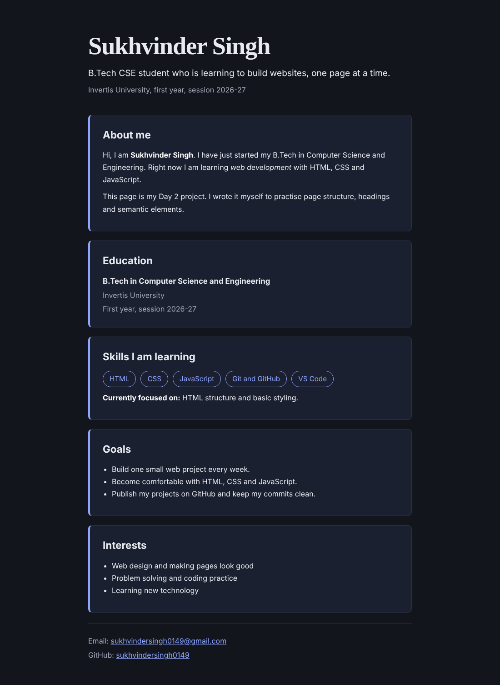

# Day 2: HTML Foundations - Personal Introduction

A personal introduction page for **Sukhvinder Singh**, a first-year B.Tech CSE student at Invertis University (session 2026-27). It is built with plain HTML and CSS and uses a dark theme.

## Screenshot

## What is inside

- `index.html` - the page structure (doctype, head, title, header, main, sections, footer)
- `style.css` - the dark theme styling, with numbered comments for each part
- `screenshots/personal-intro.png` - screenshot of the finished page

## HTML concepts used

- Document structure: `<!doctype html>`, `<html>`, `<head>`, `<title>`, `<body>`
- Text elements: headings (`h1` to `h3`), paragraphs, `<strong>` and `<em>`
- Semantic containers: `<header>`, `<main>`, `<section>`, `<footer>`
- `id` on every section (for example `id="about"`), `class` for styling (for example `class="card"`), and a `data-section` attribute that names what each section is about
- `div` to group related education details

## How to open this project

No installation is needed.

1. Download or clone this repository.
2. Open the folder in VS Code.
3. Double-click `index.html`, or right-click it and choose **Open with Live Server** if you have that extension.
4. The page opens in your browser. Edit the files, save, and refresh to see changes.

## Author

Sukhvinder Singh, Roll No. BCS2026640
